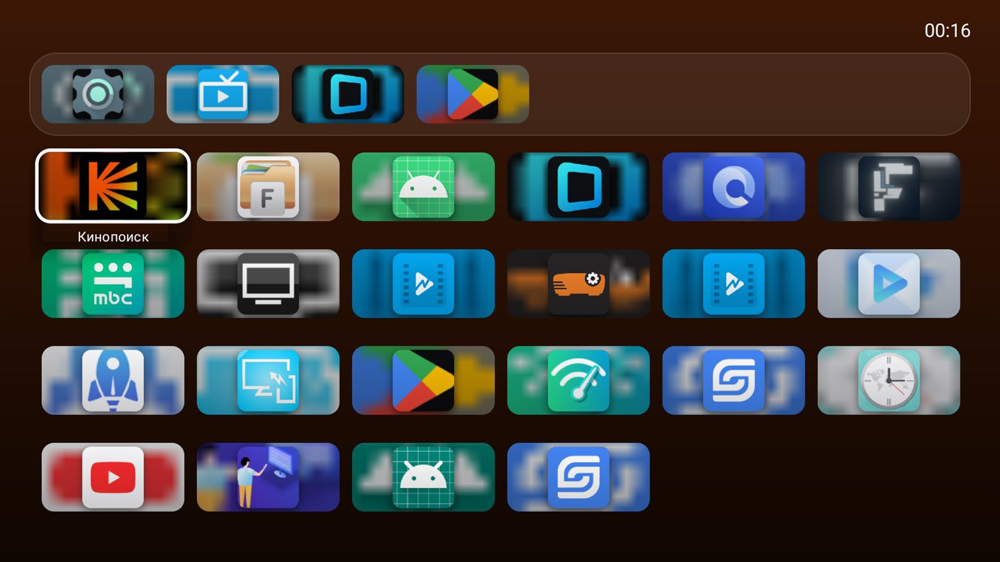
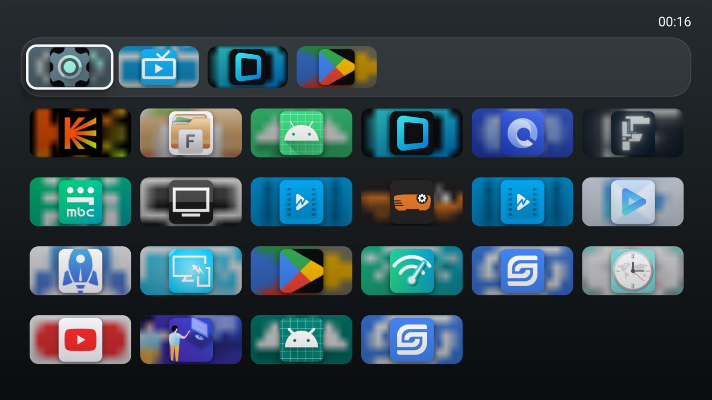

# TigrLauncher

Лёгкий домашний экран для Android TV в духе Apple TV: один `Activity`, чистый Java,
ни одной сторонней зависимости и сборка без Gradle.

A tiny Apple TV-style home screen for Android TV. Pure Java, zero dependencies, no Gradle,
no AndroidX. Tested on a cheap Android 9 Realtek TV panel.




## Зачем

На бюджетных Android TV-панелях стоковый штурман — это связка `tvlauncher` + `backdrop` +
`tvrecommendations`, которая на слабом железе запускается долго и съедает память ещё до того,
как ты открыл первое приложение. TigrLauncher сделан ровно под этот сценарий: он не пытается
быть «комбайном», а только показывает приложения и запускает их.

Замеры на реальном устройстве (методика одинаковая для всех: `am start -W -S` после
`force-stop`, память — `dumpsys meminfo`, поле `TOTAL`):

| Лаунчер | Холодный старт | Память (PSS) |
|---|---|---|
| **TigrLauncher 1.15** | **0.7–1.1 с** | **~40 МБ** |
| FLauncher 0.18 | ~10.1 с | ~78 МБ |
| Стоковый штурман (стек из трёх пакетов) | ~17.7 с | ~190 МБ |

Размер APK — **38 КБ** (весь код, ресурсы и подписи).

## Что внутри

- **Верхняя полка** — Настройки, ТВ, избранное и недавно запущенные приложения.
  Избранное добавляется долгим нажатием ОК на плитке.
- **Сетка приложений** в 6 колонок, пропорция плитки 2.07:1, как на tvOS.
- **Собственный конвейер artwork.** Android-иконки квадратные и плотные, поэтому плитка
  собирается сама: размытое «брендовое» поле из самой иконки → иконка со скруглением и тенью
  по центру → жемчужная дымка для слишком светлых плашек. Если у приложения нет иконки
  (бывает) — рисуется плитка с первой буквой названия вместо чёрной дыры.
- **Подсветка фона** под цвет иконки под фокусом: берётся самый насыщенный кластер пикселей
  (не среднее — иначе белый YouTube давал серый фон), цвет интерполируется плавно.
- **Фокус**: увеличение 1.09, тень, белое кольцо поверх artwork, подпись только у активной плитки.
- **Фильтр** приложений по кнопке MENU.
- Никаких библиотек: только framework-API Android.

## Управление

| Клавиша | Действие |
|---|---|
| Стрелки | Навигация по сетке и полке (между ними — вверх/вниз) |
| ОК | Запустить приложение |
| Долгое ОК | Меню: в избранное / о приложении |
| MENU | Фильтр по названию («Найдено: N») |
| Домой | Возврат в лаунчер, фокус остаётся на прежней плитке |

## Сборка

Нужны: `bash` (Git Bash на Windows), Android SDK (build-tools + любой `android.jar`), JDK 17+.

Пути переопределяются переменными окружения, значения по умолчанию — под Windows с Android Studio:

| Переменная | По умолчанию |
|---|---|
| `ANDROID_HOME` / `ANDROID_SDK_ROOT` | `/c/AndroidSDK` |
| `BUILD_TOOLS_VERSION` | `36.0.0` |
| `PLATFORM_VERSION` | `android-37.0` |
| `JAVA_HOME` | JBR из комплекта Android Studio |

```bash
./build.sh          # aapt2 -> javac -> d8 -> zipalign -> apksigner  =>  TigrLauncher.apk
./deploy.sh         # то же + установка по adb + назначение домашним экраном
TV=192.168.1.20:5555 ./deploy.sh    # если адрес ТВ другой
```

Ключ подписи создаётся автоматически (`keytool`), если `tigrlauncher.keystore` отсутствует.
Файл намеренно в `.gitignore`: у каждого он свой, а для обновления приложения важен
один и тот же ключ, а не один и тот же репозиторий.

`versionCode` и `versionName` находятся в `AndroidManifest.xml`.

### Установка вручную

```bash
adb install -r TigrLauncher.apk
adb shell cmd package set-home-activity \
    com.tigran.tigrlauncher/com.tigran.tigrlauncher.MainActivity
```

На Android 9 `set-home-activity` приходится повторять после каждой перезагрузки ТВ —
это ограничение прошивки, `deploy.sh` делает это сам.

## На чём проверено

- **Устройство:** Evvoli 43EV250QA (панель на Realtek RTD2851O), Android 9 / API 28,
  `armeabi-v7a`, `ro.config.low_ram=true`, плотность 320, экран рендерится в 1920×1080
  (то есть канвас 960×540 dp — от этого зависят все размеры в разметке).
- **ОС для сборки:** Windows 10 19045, Android SDK build-tools 36.0.0,
  platform `android-37.0` (`android.jar`), JDK из комплекта Android Studio (OpenJDK 25).
- На других устройствах не тестировалось. Собраться должно на всём с API 26+, но интерфейс
  подогнан под экран и плотность указанного телевизора.

## Известные особенности

- На этой прошивке нет `cmd tv_input`, но `dumpsys tv_input` работает — так получаются
  `input id` тюнера и HDMI (в плане: плитки источников вместо вендорского меню).
- Клавиша «Сон» требует `PowerManager.goToSleep()`, то есть системных разрешений —
  планировалось через `AccessibilityService`.
- Меню «О приложении» открывает системные настройки пакета; на некоторых прошивках они урезаны.

## Лицензия

Apache License 2.0 — см. [LICENSE](LICENSE). © 2026 Tigran Sarkisyan.

Дизайн вдохновлён Apple TV (tvOS): пропорции плиток, полка, подсветка фона. Ассеты Apple
не используются, кода Apple в репозитории нет.

Вклад приветствуется — см. [CONTRIBUTING.md](CONTRIBUTING.md). Согласно п. 5 Apache-2.0,
любой отправленный пул-реквест автоматически лицензируется под Apache-2.0.
